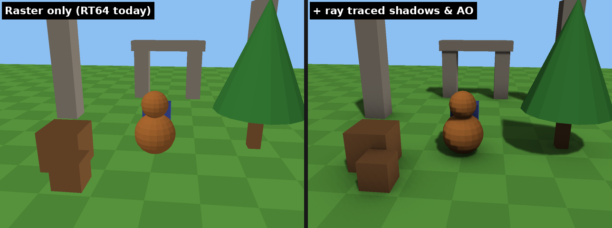
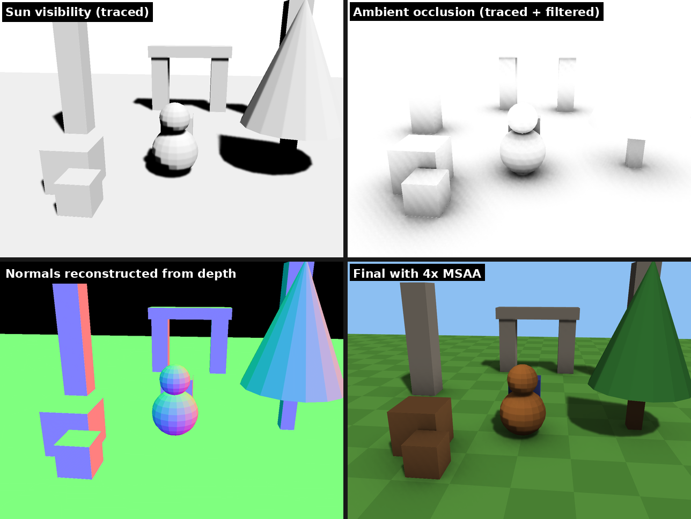
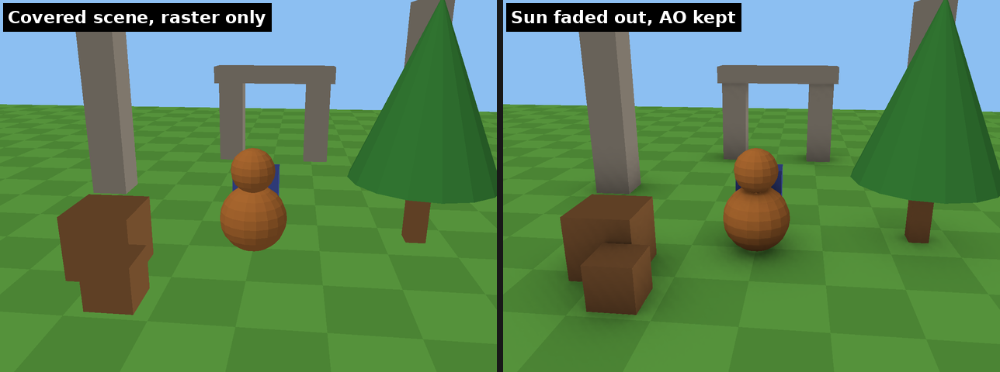

# Banjo-Kazooie hybrid ray tracing

An unofficial, personal fork of [Banjo: Recompiled](https://github.com/BanjoRecomp/BanjoRecomp). It adds ray traced sun shadows and ambient occlusion to its renderer, [RT64](https://github.com/rt64/rt64).

The game is still drawn by RT64's normal N64-accurate rasterizer. After the 3D scene is drawn and before the HUD, a ray tracing pass does the following:

1. Rebuilds the world-space geometry of the frame from RT64's own vertex data and builds a ray tracing acceleration structure from it.
2. Reconstructs the world position and surface normal of every pixel from the depth buffer.
3. Traces one soft shadow ray toward a configurable sun, plus a few short ambient occlusion rays.
4. Filters the noisy result with an edge-aware (depth and normal) blur.
5. Multiplies the result over the image. Colors, alpha and the HUD are left untouched.

Indoor scenes, where the sun is blocked nearly everywhere, are detected automatically. In those scenes the sun shadows fade out and only ambient occlusion remains.

> **This is a hobby fork and is not affiliated with or endorsed by the Banjo: Recompiled or RT64 projects.** Both projects
> state in their contributing guides that AI-generated code is not accepted. This code was written with an AI assistant,
> so **do not submit it to either upstream project** and don't report bugs you hit with it to them.

## Screenshots

These are synthetic test-scene renders from `tools/hybrid_rt_test`, which runs the real shaders through RT64's rendering backend. They use `tools/hybrid_rt_test/docs_config.json`, which sets the sun to 35° azimuth and 55° elevation so the test scene is lit from the front.





When most of the screen can't see the sun, as here or in Banjo's house, sun shadows fade out and only ambient occlusion remains:



No in-game screenshots are committed to this repository.

## Requirements

- A GPU and driver that support hardware ray tracing pipelines:
  - Vulkan: `VK_KHR_ray_tracing_pipeline` and `VK_KHR_acceleration_structure`. Examples are NVIDIA RTX 20 series and newer, AMD RX 6000 series and newer, and Intel Arc.
  - Direct3D 12: DXR.
- Without that support, the game runs exactly like upstream Banjo: Recompiled and the pass stays off.
- **Your own** NTSC-U 1.0 Banjo-Kazooie ROM (sha1 `1fe1632098865f639e22c11b9a81ee8f29c75d7a`), dumped from a cartridge you own. No ROM or ROM-derived data is included here or should ever be committed. `.gitignore` blocks the usual ROM extensions.
- macOS is not supported (the Metal backend has no ray tracing pipelines).

## Getting the source

```bash
git clone --branch claude/exciting-rubin-dzlckm https://github.com/jlpt/claudecode3.git
cd claudecode3
scripts/setup.sh          # Windows: powershell -ExecutionPolicy Bypass -File .\scripts\setup.ps1
```

`setup` checks out Banjo: Recompiled at the commit this patch was made for (`dbd52154`), along with all of its submodules. It then applies `patches/rt64-hybrid-raytracing.patch` to `BanjoRecomp/lib/rt64`. Running it again does no harm. The build scripts below run it for you.

## Building

### Windows

**1. Install the tools** (once):

- [Visual Studio 2022](https://visualstudio.microsoft.com/downloads/) (Community is fine). In the installer, select:
  - the **Desktop development with C++** workload;
  - under *Individual components*, **C++ Clang Compiler for Windows** and **C++ CMake tools for Windows**.
- [Git for Windows](https://git-scm.com/download/win).
- [Python 3](https://www.python.org/downloads/windows/). Tick *Add python.exe to PATH*.
- LLVM: run `winget install LLVM.LLVM`. It provides the `clang` and `ld.lld` that compile the game's patches.
- make: install [Chocolatey](https://chocolatey.org/install), then run `choco install make` in an administrator PowerShell.

**2. Get the code.** Use a short folder such as `C:\bk`, because some of the submodule paths are long:

```powershell
git config --global core.longpaths true
git clone --branch claude/exciting-rubin-dzlckm https://github.com/jlpt/claudecode3.git C:\bk
```

**3. Build.** Open **Developer PowerShell for VS 2022** from the Start menu. A normal PowerShell window won't work, because it doesn't have the compiler set up. Then run:

```powershell
cd C:\bk
powershell -ExecutionPolicy Bypass -File .\scripts\build.ps1 "C:\path\to\your\Banjo-Kazooie (USA).z64"
```

The script does the following:

- Fetches the sources and applies the patch.
- Decompresses your ROM with `scripts/decompress_rom.py`.
- Builds N64Recomp and RSPRecomp at the pinned commit, and runs them to turn the game code into C.
- Builds `BanjoRecomp\build-cmake\BanjoRecompiled.exe` with the same settings as Banjo: Recompiled's own Windows builds.

The first build takes a while. You only need to run it again after updating the code.

**4. Play.** Start the game from the `BanjoRecomp` folder, so it finds its `assets` folder and your `rt64_hybrid_rt.json`:

```powershell
cd C:\bk\BanjoRecomp
.\build-cmake\BanjoRecompiled.exe --show-console
```

`--show-console` opens a log window. In it you should see `RT64: Hybrid ray tracing is supported on this device.` and, once you're in a level, `RT64: Hybrid ray tracing active: ...`. Pick your normal ROM in the launcher, not the decompressed copy.

On Windows the game uses Direct3D 12 by default, and **the Direct3D 12 path has not been tested**, so Vulkan is the safer choice. The *Graphics API* option is hidden in the game's menus. To switch:

1. Start the game once, then close it.
2. Open `%LOCALAPPDATA%\BanjoRecompiled\graphics.json` in Notepad.
3. Change `"api_option": "Auto"` to `"api_option": "Vulkan"`, and while you're there set `"developer_mode": true` (see below).

### Linux

```bash
sudo apt-get install git cmake ninja-build libsdl2-dev libgtk-3-dev lld llvm clang python3
scripts/build.sh /path/to/your/banjo-kazooie.z64
```

The script does the following:

- Decompresses the ROM with `scripts/decompress_rom.py`, a dependency-free port of [bk_rom_compressor](https://github.com/MittenzHugg/bk_rom_compressor) that produces the same file byte for byte.
- Builds and runs [N64Recomp](https://github.com/N64Recomp/N64Recomp) and RSPRecomp at the pinned commit.
- Builds `BanjoRecomp/build-cmake/BanjoRecompiled`.

Run the game from inside `BanjoRecomp/` so it finds the `assets` folder.

## Using it

The effect is **on by default** when the GPU supports it. The game log prints one of these:

- `RT64: Hybrid ray tracing is supported on this device.`
- `RT64: Hybrid ray tracing active: N shadow casting triangles ...`

Settings are read from `rt64_hybrid_rt.json` in the folder the game runs from. The `RT64_HYBRID_RT_CONFIG` environment variable can point to another file. **The file is reloaded automatically when you save it**, so you can tune it while playing. Any key you leave out keeps its default:

```json
{
    "hybridRaytracing": {
        "enabled": true,
        "sunAzimuthDegrees": 215.0,
        "sunElevationDegrees": 60.0,
        "shadowStrength": 0.6,
        "aoStrength": 0.6
    }
}
```

| Setting | Default | What it does |
| --- | --- | --- |
| `enabled` | `true` | Master switch. The `RT64_HYBRID_RT=0` / `=1` environment variable overrides it. |
| `shadows` / `ambientOcclusion` | `true` | Turn either effect on or off. |
| `sunAzimuthDegrees`, `sunElevationDegrees` | `215`, `60` | Sun direction in the game's world space (Y up). |
| `sunAngularRadiusDegrees` | `1.0` | Sun size. Larger values give softer shadows. |
| `shadowStrength` | `0.6` | 0 = no shadows, 1 = black shadows. |
| `nDotLStrength` | `0.35` | How much surfaces facing away from the sun are darkened. |
| `shadowMaxDistance` | `20000` | Shadow ray length in game units. |
| `aoSamples`, `aoRadius`, `aoStrength` | `2`, `120`, `0.6` | Ambient occlusion rays per pixel, reach, and darkness. |
| `normalBias` | `2.0` | Ray start offset that prevents self-shadowing. |
| `denoiseRadius`, `denoiseDepthSigma`, `denoiseNormalPower` | `6`, `0.02`, `8` | Edge-aware blur that removes the noise. |
| `interiorDetection`, `interiorFadeStart`, `interiorFadeEnd` | `true`, `0.08`, `0.25` | Fades out sun shadows when less than this fraction of the screen sees the sun. |
| `alphaTestedCasters` | `false` | Let cut-out geometry (fences, foliage) cast shadows. They cast solid shadows because textures aren't sampled. |
| `temporalNoise` | `false` | Change the noise pattern every frame. |
| `debugView` | `0` | 0 = off, 1 = shadows, 2 = ambient occlusion, 3 = combined, 4 = normals. |

### Developer mode

Set `"developer_mode": true` in Banjo: Recompiled's `graphics.json` to unlock these:

- **F1** opens RT64's inspector. Its **Hybrid RT** tab shows the live status, has sliders for every setting, and has a Save button that writes `rt64_hybrid_rt.json`.
- **F2** toggles the effect on and off, so you can compare.

`graphics.json` is in `~/.config/BanjoRecompiled/` on Linux and `%LOCALAPPDATA%\BanjoRecompiled\` on Windows, or next to the executable in portable mode.

## Limitations

- **Only tested on a software Vulkan driver** (Mesa lavapipe, on the CPU). It has not been run on real GPU hardware or on the Direct3D 12 backend yet. If something looks wrong, set `RT64_HYBRID_RT=0` to rule it out.
- The game has no real sun. One global sun direction is used everywhere, and some spots get shadows that don't match the baked lighting. Adjust `sunAzimuthDegrees` to taste.
- Textures are not sampled during ray tracing. Cut-out geometry therefore doesn't cast shadows by default, and casts solid ones if `alphaTestedCasters` is on.
- Fixed per-pixel noise plus spatial filtering, with no temporal accumulation. Shadows are soft rather than razor sharp.
- Only the main 3D camera of each frame gets the effect, not secondary views or picture-in-picture.

## Repository layout

| Path | Contents |
| --- | --- |
| `BanjoRecomp/` | Upstream Banjo: Recompiled, as a git submodule pinned to `dbd52154`. |
| `patches/rt64-hybrid-raytracing.patch` | All the renderer changes, against RT64 `6f1c2d99`. |
| `scripts/` | Setup and build scripts for Windows and Linux, and the ROM decompressor. |
| `tools/hybrid_rt_test/` | Standalone harness that renders a synthetic scene with the real shaders, checks the depth-to-world reconstruction against the CPU, and writes PNGs. See below. |
| `docs/screenshots/` | Harness output. |

### Files the patch adds or changes in RT64

- `src/render/rt64_hybrid_raytracing.{h,cpp}`: configuration, acceleration structures, pipelines and pass recording.
- `src/shaders/HybridRt*.hlsl`, `src/shared/rt64_hybrid_raytracing_params.h`: world-space vertex, depth copy, ray tracing, denoise, interior statistics and composite shaders.
- `src/render/rt64_framebuffer_renderer.*`, `src/hle/rt64_workload_queue.cpp`: pick the main 3D camera, gather shadow-casting draws, and insert the pass before the HUD.
- `src/hle/rt64_application.*`, `src/hle/rt64_state.cpp`, `src/hle/rt64_shared_queue_resources.h`: configuration loading, hot reload, F2 toggle and inspector tab.
- `CMakeLists.txt`: the `RT64_HYBRID_RT` option (on by default) and shader builds.

### Test harness

The harness runs without the game or a ROM. On Linux, after `scripts/setup.sh`:

```bash
cmake -S tools/hybrid_rt_test -B build-harness -G Ninja -DCMAKE_C_COMPILER=clang -DCMAKE_CXX_COMPILER=clang++
cmake --build build-harness
./build-harness/hybrid_rt_test out tools/hybrid_rt_test/docs_config.json
```

Without a ray tracing GPU, it also runs on Mesa's software Vulkan driver: prefix the last command with `VK_ICD_FILENAMES=/usr/share/vulkan/icd.d/lvp_icd.json`. It renders four variants: 4:3, 4:3 with 4x MSAA, 16:9 and a covered scene. For each one it checks the depth-to-world reconstruction against a CPU reference and writes the raster, final and debug images. It was run with the Vulkan validation layers enabled and reported no errors.

## Licenses

RT64 is MIT licensed and Banjo: Recompiled is GPL-3.0. The patch and tools in this repository are offered under the same terms as the code they modify. Banjo-Kazooie is © Nintendo / Rare. This repository contains no game assets.
