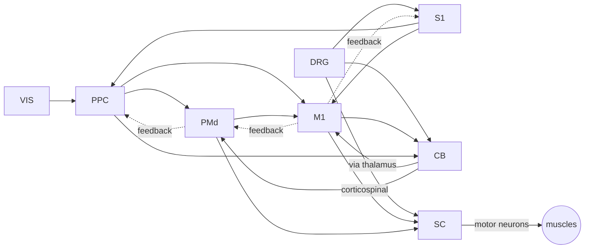

# HyperNEAT spiking limb

A two-link arm (a driven double pendulum) has to push a ball along the floor onto a target. It is controlled by a
spiking neural network whose layout copies the primate sensorimotor system: regions, cortical layers, cell types,
excitatory and inhibitory neurons, topographic body maps and the wiring between them. HyperNEAT evolves a CPPN that
paints the synaptic weights onto that brain.

Only numpy is needed. Everything (physics, Izhikevich neurons, NEAT, HyperNEAT, the viewer) is in this folder.

```bash
git clone -b claude/upbeat-bell-zacr9h https://github.com/jlpt/claudecode3.git
cd claudecode3/hyperneat_arm
pip install -r requirements.txt
python train.py --generations 300 --workers 4 --out runs/demo     # evolve (Ctrl-C safe, see --resume)
python replay.py runs/demo/champion.json --html runs/demo/replay.html
python -m unittest discover -s tests -t .
```

`replay.html` is a self-contained page: the arm and ball, the brain map lighting up spike by spike, a raster of
every neuron and the muscle activations, with a trial picker and a time scrubber.

## The task

Side view, gravity down, floor at y = 0. The shoulder is a fixed pivot 73 cm above the floor.

| Part | Model |
|---|---|
| Arm | Upper arm 35 cm / 2 kg, forearm + hand 35 cm / 1.5 kg, uniform rods. Full double pendulum dynamics `M(q)q'' + C(q,q') + G(q) = tau`, semi-implicit Euler at 1 ms. Shoulder ±115°, elbow 0–150° (flexes one way, like a human elbow), soft joint limits, joint friction. |
| Muscles | A flexor and an extensor at each joint. Each low-pass filters its motor pool's firing rate (40 ms twitch) and saturates. Torque = strength × (flexor − extensor); co-contraction stiffens the joint. Shoulder 20 N·m, elbow 12 N·m, about twice what it takes to hold the arm out straight. |
| Ball | 10 cm radius, 0.4 kg, rolls on the floor (hollow-sphere rolling inertia and rolling resistance, so a pushed ball slows and stops), bounces off walls at ±90 cm. Penalty contacts with both arm links (capsules) and the floor. |
| Trial | Arm starts hanging still. Ball rests at `ball_x`, target spot at `target_x`. 3 s to push the ball onto the target (5 cm tolerance) and leave it there. |

The eight training placements come in contrast pairs (`hnarm/evaluate.py: TRAIN_TRIALS`): each ball position appears
twice, once with the target further out and once with it back toward the body. A brain that ignores the target can
win at most one of each pair. `replay.py` also tests random placements the brain never saw, and runs a target test:
it keeps the ball still, moves only the target, and reports whether the ball's final position changes by more than
noise alone would explain.

Fitness, averaged over trials:

- how much closer the ball ended up (`1 − final_error / initial_error`);
- a bonus for landing on target (`exp(−(error/5 cm)²)`);
- partial credit for moving the ball toward the target at all, even too far;
- a small shaping term for touching the ball;
- minus a metabolic cost (mean squared muscle activation);
- minus a penalty for cortical neurons firing above 40 Hz.

`final_error` is averaged over the last 0.5 s, so a ball that rolls through the target does not count.

The last two terms come from a failed run. Its champion made the same backward swing in every trial, which happens
to land two of the six placements. Its cortex had saturated: every layer 2/3 cell fired at 70–90 Hz because
cortico-cortical feedback loops were fully switched on. A saturated cortex cannot carry the few visual spikes that
say where the ball and target are, so moving the target changed nothing (cutting vision off only dropped success
from 33% to 25%). The saturation penalty and weaker feedback keep the cortex in a range where it can encode the
scene. The direction term rewards the first small step toward a movement that depends on what the brain sees.

A second run, with the cortex no longer saturated, was still blind at generation 25. The placements were the culprit:
no two shared a ball position, so a swing that only reacted to where the ball was (a few centimetres changing how a
fixed swing hits it) could score without looking at the target. That is why the placements now come in pairs.

## The brain

203 Izhikevich neurons, 79 of them afferents, in 8 regions. 4,704 synapses are anatomically possible; the CPPN decides
which exist and how strong they are.

| Region | Populations (cell model) | Role |
|---|---|---|
| VIS, visual cortex | ball, target and hand maps, 7×3 retinotopic receptive fields each | Where things are |
| DRG, dorsal root ganglia | joint-angle afferents (population code), Ia spindle afferents (one per muscle), touch afferents | Where the arm is, how fast muscles stretch, what it touches |
| S1, somatosensory cortex | L2/3 pyramidal (RS), interneurons (FS), L5 pyramidal (IB) | Body sense |
| PPC, posterior parietal cortex | L2/3 (RS), interneurons (FS), L5 (IB) | Combines vision and body sense into a reach plan |
| PMd, dorsal premotor cortex | L2/3 (RS), interneurons (FS), L5 (IB) | Movement preparation |
| M1, primary motor cortex | L2/3 (RS), interneurons (FS), L5 corticospinal cells (IB) | Somatotopic motor commands |
| CB, cerebellum | granule cells (RS), Purkinje cells (FS, inhibitory), deep nuclei (TC, rebound bursting) | Correction from efference copy and proprioception |
| SC, spinal cord | excitatory interneurons (RS), Ia inhibitory interneurons (FS), Renshaw cells (FS), 4 × 4 alpha motor neurons | Reflexes, reciprocal inhibition, final common path |



What makes it brain-like rather than a generic layered net:

- **Connectome.** Synapses can only exist along real pathways (`hnarm/brain.py: _build_projections`), grouped into
  tracts: afferent/thalamocortical, cortico-cortical feedforward (L2/3 → next area) and feedback (L5 → L2/3 of the
  area before), local microcircuits, the cerebellar loop (mossy fibres → granule cells → Purkinje cells ⊣ deep nuclei
  → thalamus → M1), corticospinal, and spinal reflex circuits (monosynaptic stretch reflex, Ia reciprocal inhibition,
  Renshaw recurrent inhibition).
- **Layers.** Each cortical area has L2/3 cells that talk to other areas and L5 cells that send output to the
  cerebellum and spinal cord, as in cortex.
- **Dale's principle.** Every neuron is excitatory or inhibitory and all its synapses share the sign. Inhibitory cells
  only act locally (interneurons, Purkinje cells, spinal interneurons), like the real ones.
- **Topographic maps share an axis.** Local coordinate `z` is the somatotopic body map (shoulder medial, elbow
  lateral) in the afferents, S1, M1, the cerebellum and the spinal motor pools, and the horizontal retinotopic axis in
  vision. Coordinate `b` is laminar depth (or the dorsoventral lamina in the spinal cord), `a` a secondary map
  (elevation, preferred angle, flexor/extensor side). HyperNEAT works on exactly this kind of geometry: one Gaussian of
  `z_post − z_pre` wires matching body parts together across every area at once.
- **Cell types.** Izhikevich (2003) dynamics: regular spiking pyramidal cells, bursting L5 cells, fast-spiking
  interneurons, rebound-bursting cerebellar nuclei, tonic afferents and motor neurons.
- **Synapses.** Current-based, decaying with 5 ms (excitatory, AMPA-like) or 10 ms (inhibitory, GABA_A-like) time
  constants, with background noise.
- **Periphery.** Receptive-field population codes going in, agonist/antagonist muscles with twitch dynamics coming out.

## HyperNEAT

The CPPN has 8 inputs: the presynaptic neuron's local `(z, a, b)`, the postsynaptic neuron's `(z, a, b)`, and the
displacement `(dx, dy)` between their regions on a sagittal brain map. It has one output per tract plus a bias
output (the multi-spatial-substrate idea from Pugh & Stanley, so the cerebellar loop and the spinal reflexes can
evolve different patterns while sharing hidden nodes).

For each allowed synapse, the output of its tract is read. Below 0.2 there is no synapse; above, the weight is
`(out − 0.2)/0.8 × tract_gain / sqrt(presynaptic population size)`, with the sign set by the presynaptic cell. The
bias output, queried with only the postsynaptic coordinates, sets each neuron's tonic current. Every initial CPPN is
seeded with the topographic Gaussian described above.

NEAT (`hnarm/neat.py`) is a full implementation: historical markings, speciation with an adaptive threshold,
fitness sharing, stagnation, elitism, crossover, and add-node / add-connection / activation mutations over
sin, Gaussian, sigmoid, tanh, abs, identity and ReLU nodes.

### Training against noise

The brain's background noise makes the arm's chaotic dynamics diverge from run to run. In a first version every
generation saw the same frozen noise, and evolution learned to exploit that one pattern: a champion that hit 2 of 6
targets scored −0.2 instead of +0.94 with the noise switched off. So now:

- every generation draws fresh noise, and every genome, elites included, is re-scored on it;
- each placement is played `--repeats` times (default 2) with different noise;
- every 5 generations the top 3 genomes are scored on separate validation noise (8 placements × 4 repeats), and the
  best of those is saved as `champion.json`.

`replay.py` reports how often the champion lands on target over 10 further noise repeats per placement, on the
training placements and on held-out ones.

## Files

| File | |
|---|---|
| `hnarm/world.py` | Batched double-pendulum arm, ball, contacts |
| `hnarm/brain.py` | Regions, populations, coordinates, connectome, CPPN queries |
| `hnarm/periphery.py` | Receptors (vision, proprioception, touch) and muscles |
| `hnarm/snn.py` | Batched Izhikevich network |
| `hnarm/neat.py` | NEAT for CPPNs |
| `hnarm/hyperneat.py` | CPPN → weights and biases on the substrate |
| `hnarm/evaluate.py` | Trials, fitness, multiprocess evaluation |
| `hnarm/viewer.py` | HTML replay |
| `hnarm/config.py` | Every parameter, saved with each champion |
| `train.py`, `replay.py` | Command-line entry points |

Speed: all genomes in a worker and all their trials are simulated as one numpy batch. With the defaults
(150 genomes × 8 placements × 2 repeats × 3 s at 1 ms) a generation takes about 15 s on 4 cores.

## Simplifications

- No learning within a lifetime: weights are fixed once the CPPN paints them. STDP or cerebellar plasticity driven
  by climbing-fibre error signals would be the natural next step.
- 203 neurons stand in for billions, so each "population" is a handful of cells.
- The thalamus is folded into the afferent and cerebellar projections, and there are no basal ganglia.
- Conduction delays are a uniform 1 ms step.
- The arm moves in one vertical plane, and the ball has no spin of its own beyond rolling inertia.
